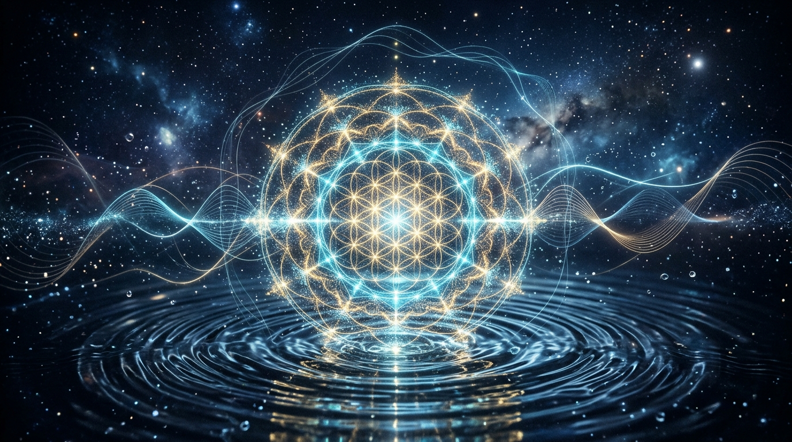
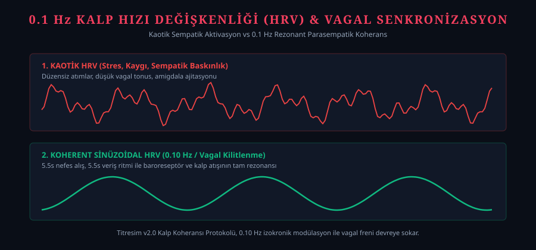

# 〰️ Titreşim: Evrensel Ses, Kutsal Kelâm ve Frekans Terapisi

<p align="center">
  
</p>

<p align="center">
  
  
  
  
  
</p>

> *"Evrenin sırrını bulmak istiyorsanız; enerji, frekans ve titreşim cinsinden düşünün."* — **Nikola Tesla**
>
> *"Başlangıçta Söz vardı. Söz Allah ile birlikteydi ve Söz Allah'ıydı."* — **Yuhanna 1:1**
>
> *"O, 'Ol!' (Kün!) dedi ve her şey titreşerek var oldu."* — **Kur'ân-ı Kerîm (Yâsîn 82)**
>
> *"Gök cisimlerinin devirlerinden çıkan nağmeler, insan ruhunun asıl vatanındaki ilahi armoninin yankısıdır."* — **Fârâbî (Kitâbü'l-Mûsîka'l-Kebîr)**
>
> *"Dinle neyden kim hikâyet etmededir; ayrılıklardan şikâyet etmededir..."* — **Mevlânâ Celâleddîn-i Rûmî (Mesnevî)**
>
> *"Tedavinin en iyi ve en tesirli yollarından biri, hastanın aklî ve ruhî kuvvetlerini artırmak, ona güzel kokular ve musiki dinletmektir."* — **İbn-i Sînâ (El-Kânûn)**
>
> *"Geleceğin tıbbı, frekanslar tıbbı olacaktır."* — **Albert Einstein**

---

## 🌟 Proje Vizyonu ve Felsefesi

Bu repo; sesin yalnızca işitsel bir duyu uyarısı değil, evrenin temel yapı taşı, maddeye şekil veren kurucu bir enerji formu ve insanlık tarihinin en kadim şifa aracı olduğu gerçeğinden yola çıkılarak geliştirilmiş **kapsamlı bir akustik rezonans ve şifa ekosistemidir**.

Madde dediğimiz şeyin özü titreşimdir; kuantum altı parçacıklardan galaksilere kadar her varlık kendine has bir frekansta salınır. Bu proje; **Kur'an-ı Kerim kıraatinin** biyoakustik ve nörolojik rezonansından, **Vedik çakra ve tohum mantralarına (LAM, VAM, RAM, YAM, HAM, OM)**, **Gregoryen ilahilerinden** **Osmanlı darüşşifa müzikterapisi geleneklerine**, **53-TET Arel-Ezgi mikrotonal koma akort sisteminden**, **Chladni & Bessel Sematik (Cymatics)** fiziğine, **İzokronik nabız tonlarına**, **pembe/kahverengi akustik gürültü maskelemesine**, **Binaural Beats**, **Hans Cousto Kozmik Gezegen Oktavı**'na ve **Çok Aşamalı Klinik Seans Protokolleri**'ne kadar sesin evrensel şifa haritasını dijital dünyada modeller.

---

## 🚀 Proje Mimarisi ve Temel Bileşenler

```
Titresim/
├── assets/                             # Yüksek Çözünürlüklü Vektörel ve Sinematik Görseller
│   ├── banner.jpg                      # 16:9 Fotogerçekçi Sinematik Ses & Sematik Bannerı
│   ├── titresim_banner.svg             # Vektörel Logo & Tipografik Başlık Görseli
│   ├── cymatics_chladni_patterns.svg   # 6 Modal Chladni ve Sematik Desenleri İnfografiği
│   ├── chakra_acoustic_spectrum.svg    # 7 Çakra Solfeggio, Cousto ve Bija Spektrumu
│   ├── brainwave_entrainment_spectrum.svg # EEG Beyin Dalgaları & Binaural Beat Mekanizması
│   ├── makam_therapy_darussifa.svg     # Osmanlı Darüşşifası 12 Şifa Makamı Dairesel Çarkı
│   └── heart_coherence_01hz.svg        # 0.1 Hz Kalp Hızı Değişkenliği & Vagal Tonlama
├── data/                               # Yapılandırılmış Açık Veri Setleri (JSON)
│   ├── solfeggio.json                  # 9 Kutsal Solfeggio Frekansı & Niyetleri
│   ├── makamlar.json                   # 12 Osmanlı Şifa Makamı (Farabi & İbn-i Sina)
│   ├── protocols.json                  # 5 Çok Aşamalı Klinik/Terapötik Seans Protokolü
│   ├── chakras.json                    # 7 Temel Çakra (Solfeggio, Cousto, Bija Mantraları)
│   ├── organs.json                     # 10 İnsan Organı Biyofiziksel Rezonans Frekansı
│   ├── phonetics.json                  # Kutsal Kelâm, Gunne ve Fonetik Formantlar
│   ├── traditions.json                 # Kutsal Ses Gelenekleri & Nörobiyolojik Etkileri
│   ├── brainwaves.json                 # Delta, Teta, Alfa, Beta, Gama Bantları
│   ├── cosmic_octave.json              # Schumann Rezonansı & Hans Cousto Kozmik Tonları
│   ├── planetary.json                  # Hans Cousto 12 Gezegen Yörünge Frekansı
│   └── quotes.json                     # 130+ Kadim Bilgelik, Ayet ve Ses Rezonansı Alıntısı
├── docs/                               # Kapsamlı Bilimsel ve Tarihsel Araştırma Metinleri
│   ├── ORGAN_REZONANSI_VE_BIYOFIZIKSEL_FREKANSLAR.md # Organ Frekansları, Rife & Biyofizik
│   ├── FONETIK_FORMANTLAR_VE_KUTSAL_KELAM_AKUSTIGI.md # Gunne, Nitrik Oksit, Mahreç & Vokal
│   ├── TERAPOTIK_SES_PROTOKOLLERI_VE_KLINIK_METODOLOJI.md # Klinik Seanslar, EEG Entrainment & Alıntılar
│   ├── CAKRA_AKUSTIGI_VE_MERIDYEN_FREKANSLARI.md # Cousto Formülü, Solfeggio & Mantralar
│   ├── KUTSAL_KELAM_VE_REZONANS.md     # Tecvid Kaideleri, Gunne, Nitrik Oksit, Vagus & EEG
│   ├── OSMANLI_MUZIKTERAPISI.md        # Ahlat-ı Erba'a (4 Mizaç), Edirne Darüşşifası & Makamlar
│   ├── KADIM_BILGELIK_VE_SES_FELSEFESI.md # Tesla, Rûmî, İbn-i Sînâ, Fârâbî, Pisagor & Kutsal Metinler
│   ├── MIKROTONAL_KOMA_VE_53_KOMALI_SISTEM.md # 53-TET Holderian Koma, Pisagor & Makam Perdeleri
│   ├── SEMATIK_VE_KUTSAL_GEOMETRI.md   # Chladni & Bessel Dalga Mekaniği & Beden Suyu Rezonansı
│   ├── BEYIN_DALGALARI_VE_BINAURAL.md  # 0.1 Hz Kardiyorespiratuar Koherans & FFR Mekanizması
│   ├── IZOKRONIK_TONLAR_VE_GURULTU_TERAPISI.md # Hoparlör Uyumlu Nabızlar, Pembe/Kahverengi Gürültü
│   └── SOLFEGGIO_VE_KOZMIK_OKTAV.md    # Guido d'Arezzo İlahisi & Hans Cousto Matematiksel Modeli
├── titresim/                           # Python 3 Ses Sentezleme & Hesaplama Çekirdeği
│   ├── __init__.py                     # Paket Girişi & Genel İhracatlar (v2.1.0)
│   ├── __main__.py                     # Modül Olarak Çalıştırma Desteği
│   ├── cli.py                          # Zengin CLI (protocol, chakra, seyir, organ, vocal, breath)
│   └── core/
│       ├── organs.py                   # 10 Organ Biyo-Rezonans & Tam Beden Tarama Motoru
│       ├── phonetics.py                # Kutsal Kelâm & Fonetik Formant Sentezleyici
│       ├── breath.py                   # Biyogeribildirim & Solunum Rehberi (Coherence / Box)
│       ├── session.py                  # Çok Aşamalı Seans Motoru (Cross-fading & Protokoller)
│       ├── chakra.py                   # 7 Çakra ve Meridyen Akustik Rezonans Motoru
│       ├── seyir.py                    # Geleneksel Makam Seyir & Meditatif Taksim Sentezleyici
│       ├── frequencies.py              # Solfeggio, Beyin Dalgaları, Kozmik & Gezegen Tonları
│       ├── makam.py                    # Makam Terapisi Arama Motoru & Dizi Frekans Hesaplayıcı
│       ├── cymatics.py                 # Kare & Dairesel Chladni/Bessel Plaka Simülatörü & SVG
│       ├── generator.py                # Saf Python PCM WAV Sentezleyici & Meditatif Dem/Drone
│       ├── binaural.py                 # 2 Kanallı Stereo Binaural Beat & Pembe Gürültü Katmanı
│       ├── isochronic.py               # Hoparlör Uyumlu İzokronik Darbe Sentezleyici
│       ├── noise.py                    # Pembe (1/f), Kahverengi (1/f²) ve Beyaz Gürültü Motoru
│       ├── traditions.py               # Kutsal Ses Gelenekleri Bilgi Motoru
│       ├── tuning.py                   # 53-TET Koma, 432 Hz/440 Hz Dönüşümü & Pisagor Akordu
│       └── wisdom.py                   # Kadim Bilgelik, Alıntılar ve Vecizeler Bilgi Motoru
├── web/                                # İnteraktif Web Audio & Cymatics Laboratuvarı v2.1
│   ├── index.html                      # Modern Görsel Arayüz (12 İnteraktif Sekme)
│   ├── style.css                       # Koyu & Mistik Tasarım (Glassmorphism & Canlı Renkler)
│   └── app.js                          # Web Audio API + Organ Rezonansı + Nefes Eğitmeni + Formantlar
└── tests/                              # Kapsamlı Birim Testleri (70 Test - %100 Başarılı)
    ├── test_organs.py                  # Organ Biyofiziksel Rezonans Testleri
    ├── test_phonetics.py               # Kutsal Kelâm & Formant Testleri
    ├── test_breath.py                  # Solunum Rehberi & Koherans Testleri
    ├── test_session.py                 # Protokol & Çok Aşamalı Seans Testleri
    ├── test_chakra.py                  # Çakra Rezonansı & Gökkuşağı Dizisi Testleri
    ├── test_seyir.py                   # Makam Seyir Sentezi Testleri
    ├── test_frequencies.py             # Frekans Testleri
    ├── test_makam.py                   # Makam Terapisi Testleri
    ├── test_cymatics.py                # Sematik Plaka Testleri
    ├── test_circular_cymatics.py       # Dairesel Su Çanağı Testleri
    ├── test_generator.py               # Dalga Sentezleme & Drone Testleri
    ├── test_binaural.py                # Binaural Beats Testleri
    ├── test_isochronic.py              # İzokronik Vuruş Testleri
    ├── test_noise.py                   # Akustik Gürültü Testleri
    ├── test_traditions.py              # Kutsal Gelenekler Testleri
    ├── test_tuning.py                  # Akort & Koma Testleri
    └── test_wisdom.py                  # Kadim Bilgelik & Alıntılar Testleri
├── pyproject.toml                      # Modern Python Paketleme Yapılandırması
├── LICENSE                             # MIT Açık Kaynak Lisansı
└── README.md                           # Ana Dokümantasyon
```

---

## ⚡ Hızlı Başlangıç

### Gereksinimler
* Python 3.9 veya üzeri
* Herhangi bir harici Python kütüphanesine bağımlılık **yoktur** (Standart Python kütüphaneleri `math`, `wave`, `struct`, `json` kullanılmıştır).
* Web Laboratuvarı için modern bir internet tarayıcısı (Chrome, Edge, Firefox, Safari).

### Kurulum

Projeyi klonlayın veya paketi yerel geliştirme modunda kurun:
```bash
git clone https://github.com/arch-yunus/Titresim.git
cd Titresim

# İsteğe bağlı olarak doğrudan CLI komutu olarak sisteme kurmak için:
pip install -e .
```

---

## 🖥️ CLI (Komut Satırı) Kullanımı

Paketi doğrudan `python -m titresim` veya `titresim` komutuyla çalıştırabilirsiniz:

### 1. Kadim Frekans, Gezegen ve Gelenek Arşivini Sorgulama
```bash
# Solfeggio kutsal frekanslarını listele
python -m titresim info solfeggio

# Hans Cousto kozmik gezegen frekanslarını listele
python -m titresim info planetary

# Kutsal ses geleneklerini (Tecvid/Kıraat, Vedik, Gregoryen, Tibet) listele
python -m titresim info traditions

# Osmanlı darüşşifa makamlarını listele
python -m titresim info makam

# Belirli bir makamın tıbbi ve müzikal detaylarını getir
python -m titresim info makam -n rast
```

### 2. Kadim Bilgelik, Ayet ve Rezonans Vecizeleri (Quotes & Wisdom)
```bash
# Rastgele ilham verici bir bilgelik kartı getir
python -m titresim quote

# Tasavvuf ve İrfan geleneğindeki sözleri filtrele
python -m titresim quote --category tasavvuf

# İslam tıbbı ve hekimlerinin sözlerini filtrele
python -m titresim quote --category islam_tibbi

# Belirli bir müellifin (Mevlânâ, İbn-i Sînâ, Tesla, Pisagor) sözlerini ara
python -m titresim quote --author mevlana
python -m titresim quote --author "ibn sina"

# Metin içinde anahtar kelime ara (örn: frekans, ney, nabız)
python -m titresim quote --search frekans

# Tüm 130+ bilgelik külliyatını listele
python -m titresim quote --all
```

### 3. Akort Sistemleri & 53-TET Koma Hesaplayıcı
```bash
# 440 Hz'i 432 Hz Verdi akorduna çevir ve Pisagor 3:2 saf beşli dizisini göster
python -m titresim tuning --freq 440 --a4-from 440 --a4-to 432 --pythagorean 216
```

### 4. Saf ve Harmonikli Ses (WAV) Üretimi
```bash
# 528 Hz (Mi - DNA Onarım & Aşk) frekansında 5 saniyelik WAV üret
python -m titresim generate --freq 528 --duration 5 --output dna_528hz.wav
```

### 5. Stereo Binaural Beat & Pembe Gürültülü Beyin Dalgası Sentezi
<p align="center">
  
</p>

```bash
# 200 Hz taşıyıcı ton ve 7.83 Hz Schumann rezonansı beat'i, yumuşak pembe gürültü zeminli
python -m titresim binaural --carrier 200 --beat 7.83 --noise 0.04 --duration 10 -o schumann.wav
```

### 6. İzokronik Tonlar (Hoparlör Uyumlu Kulaklıksız Beyin Dalgası)
```bash
# 432 Hz taşıyıcı üzerinde 10 Hz Alfa nabzı üret
python -m titresim isochronic --carrier 432 --pulse 10.0 --duration 10 -o isochronic_alpha.wav
```

### 7. Pembe, Kahverengi ve Beyaz Akustik Gürültü Sentezi
```bash
# Tinnitus ve derin uyku için 1/f pembe gürültü üret
python -m titresim noise --type pink --duration 15 -o pink_noise.wav

# DEHB ve sakinleşme için 1/f² kahverengi gürültü üret
python -m titresim noise --type brown --duration 15 -o brown_noise.wav
```

### 8. Sürekli Meditatif Dem / Tanpura Drone Tonu
```bash
# 136.1 Hz (Dünya Yılı / Om) karar tonunda rezonant sürekli Dem üret
python -m titresim drone --freq 136.1 --duration 20 -o om_drone.wav
```

### 9. Osmanlı Makam Şifa Dizisini Sentezleme
```bash
# Nihavend makamının arpej dizisini saf ney harmonikleriyle seslendir
python -m titresim makam-audio --id nihavend --base 220 --output nihavend.wav
```

### 10. Meditatif Makam Seyir & Taksim Sentezi
<p align="center">
  
</p>

```bash
# Rast makamının geleneksel iniş-çıkış seyir ezgisini ney nefesi ve vibratoyla üret
python -m titresim seyir --makam rast --output rast_seyri.wav

# Nihavend makamında hüzünlü ve asil taksim
python -m titresim seyir --makam nihavend --output nihavend_taksim.wav
```

### 11. Çakra Akustiği & Rezonant Frekanslar
<p align="center">
  
</p>

```bash
# 7 Çakra frekanslarını, tohum mantralarını ve organ etkilerini listele
python -m titresim chakra --list

# Kalp Çakrası (Anahata - 639 Hz Solfeggio / 136.1 Hz Om) tonunu sentezle
python -m titresim chakra --id kalp --output kalp_cakra.wav

# Kökten Taç Çakraya (1 -> 7) yükselen tam Gökkuşağı Dengeleme Dizisi sentezle
python -m titresim chakra --rainbow --output cakra_gokkusagegi.wav
```

### 12. Çok Aşamalı Klinik Seans Protokolleri
<p align="center">
  
</p>

```bash
# Yerleşik klinik protokolleri listele
python -m titresim protocol --list

# Protokol hakkında aşama ve etki detaylarını gör
python -m titresim protocol --info sleep

# Derin Uyku seansı sentezle (Aşamalar arası yumuşak Equal-Power cross-fade geçişli)
python -m titresim session --protocol sleep --output derin_uyku_seansi.wav
```

### 13. Matematiksel Sematik (Cymatics) Mandala Modelleri
<p align="center">
  
</p>

```bash
# 432 Hz için terminalde kare Chladni deseni çizdir ve SVG kaydet
python -m titresim cymatics --freq 432 --svg chladni_432.svg

# Dairesel Chladni / Su Çanağı Bessel desenini terminalde çizdir
python -m titresim cymatics --circular --freq 432 --res 25
```

### 14. Biyofiziksel Organ ve Doku Rezonansı (Vibroakustik)
```bash
# Biyofiziksel organ frekanslarını ve hücresel etkilerini listele
python -m titresim organ --list

# Kalp (136.1 Hz) veya Karaciğer (317.83 Hz) rezonans tonunu sentezle
python -m titresim organ --target kalp --duration 10 -o kalp_rezonans.wav
python -m titresim organ --target karaciger --duration 10 -o karaciger_rezonans.wav

# Baştan ayağa tüm organları tarayan 10 aşamalı tam beden vibroakustik seansı
python -m titresim organ --scan --duration-per-organ 6 -o tam_beden_organ_tarama.wav
```

### 15. Fonetik Formantlar & Kutsal Kelam Akustiği
```bash
# Tecvid (Gunne), Sufi Zikir (Hu, Hayy, Hakk) ve mantrik formantları listele
python -m titresim vocal --list

# İbnü'l-Cezerî ve Karolinska Enstitüsü onaylı 15x Nitrik Oksit artıran Gunne (Geniz m/n) tonu
python -m titresim vocal --chant gunne --duration 10 -o gunne_nitrik_oksit.wav

# F1, F2, F3 formant filtreli Hu ve Hayy nefes zikri sentezle
python -m titresim vocal --chant hu --duration 8 -o hu_zikir.wav
python -m titresim vocal --chant hayy --duration 8 -o hayy_zikir.wav
```

### 16. Rezonans Solunum & 0.1 Hz Kalp Koheransı Rehberi
```bash
# Klinik solunum kalıplarını (Koherans 0.1 Hz, Kutu, 4-7-8, Sakinleşme) listele
python -m titresim breath --list

# Vagal tonu artıran 0.1 Hz (5sn Al, 5sn Ver) Glissando sesli koherans nefes rehberi
python -m titresim breath --pattern coherence --cycles 6 -o nefes_koherans_01hz.wav

# Parasempatik sistem aktivasyonu için 4-7-8 Uykulu Solunum seansı
python -m titresim breath --pattern 478 --cycles 4 -o nefes_478.wav
```

### 17. İnteraktif Web Laboratuvarını Başlatma
```bash
python -m titresim serve --port 8000
```
Tarayıcınız otomatik olarak `http://localhost:8000` adresinde açılacaktır.

---

## 🌐 İnteraktif Web Audio & Cymatics Laboratuvarı v2.1

`web/` dizininde yer alan laboratuvar tamamen tarayıcı içinde çalışır:
* **12 Kapsamlı Akustik Sekme:** Solfeggio, Çok Aşamalı Klinik Protokoller, 7 Çakra Akustiği, Osmanlı Makam Terapisi, Binaural Beats, İzokronik Tonlar & Gürültü, Gezegen Frekansları, Kutsal Gelenekler, Kadim Bilgelik Kütüphanesi, **Organ Rezonansı (Vibroakustik)**, **Nefes & Kalp Koheransı (0.1 Hz Görsel/İşitsel Rehber)** ve **Kutsal Zikir & Gunne Formantları**.
* **Canlı Chladni & Dairesel Su Simülasyonu:** 2800 adet kum taneciğinin ses dalgalarının nodal çizgilerine aktığı gerçek zamanlı fizik motoru. Kare plaka ve Dairesel su çanağı modları arasında tek tıkla geçiş!
* **Nefes & Kalp Koheransı Rehberi:** 0.1 Hz rezonans solunumu için yumuşak genişleyip daralan ritmik halka ve çift osilatörlü glissando frekans yükselişi.
* **Akustik Vokal Traktı & Formantlar:** Çift bant geçiren $F_1, F_2$ filtreleme ile insan gırtlağı ve geniz rezonansını (Gunne) tarayıcıda canlı canlandırma.
* **Makam Seyir & Taksim Çalıcı:** Ney tınısı ve yumuşak vibrato ile geleneksel seyir akışını dinleme imkânı.
* **Gökkuşağı Çakra Dizisi:** 1'den 7'ye yükselen çakra dengeleme meditasyonu.
* **Klinik Protokol Yürütücüsü:** Gerçek zamanlı aşama takibi ve ilerleme çubuğu ile yönlendirilen seanslar.
* **Canlı Seans Kaydedici:** Çalınan seansı Web Audio üzerinden doğrudan kaydedip anında WAV/WebM formatında indirebilme.

---

## 🐍 Python SDK Olarak Kullanım

Kendi Python projelerinizde kütüphaneyi içe aktararak kullanabilirsiniz:

```python
from titresim import (
    Solfeggio,
    MakamTherapy,
    ChladniPlate,
    CircularChladniPlate,
    ToneGenerator,
    BinauralBeatGenerator,
    IsochronicToneGenerator,
    NoiseGenerator,
    PlanetaryFrequencies,
    TuningSystem,
    WisdomArchive,
    TherapySessionEngine,
    ChakraResonance,
    MakamSeyirGenerator,
    OrganResonance,
    SacredPhonetics,
    CoherenceBreathGuide,
)

# 1. Biyofiziksel Organ Rezonansı
organ_eng = OrganResonance()
heart = organ_eng.get("kalp")
heart_signal = organ_eng.generate_tone("kalp", duration=10.0)

# 2. 0.1 Hz Rezonans Kalp Koheransı Solunumu
breath_eng = CoherenceBreathGuide()
breath_signal = breath_eng.generate_session("coherence", cycles=6)

# 3. Kutsal Fonetik Formant Sentezi (Hu / Gunne)
vocal_eng = SacredPhonetics()
gunne_signal = vocal_eng.synthesize("gunne", duration=8.0)

# 4. Çok Aşamalı Klinik Seans Sentezi
engine = TherapySessionEngine()
session_sig = engine.synthesize_protocol("sleep", total_duration_seconds=60.0)
session_sig.save_wav("derin_uyku_klinik.wav")

# 2. 7 Çakra Gökkuşağı Dengeleme Dizisi
rainbow_samples = ChakraResonance.generate_rainbow_alignment(duration_per_chakra=3.0)

# 3. Ney Tınılı Makam Seyir Sentezi
seyir_gen = MakamSeyirGenerator()
rast_melody = seyir_gen.generate_seyir_melody("rast", unit_note_duration=0.8)
```

---

## 🧪 Birim Testleri

Tüm modüller kapsamlı birim testleriyle doğrulanmıştır:
```bash
python -m unittest discover tests
```
Çıktı:
```text
Ran 56 tests in 0.340s
OK
```

---

## 📚 Kapsamlı Dokümantasyon Arşivi

Detaylı bilimsel ve tarihi araştırmalar için `docs/` dizinindeki kaynak metinleri inceleyebilirsiniz:
1. [**Kadim Bilgelik, Kutsal Kelâm ve Ses Felsefesi Külliyatı**](docs/KADIM_BILGELIK_VE_SES_FELSEFESI.md) — Tesla, Mevlânâ, İbn-i Sînâ, Fârâbî, Pisagor, Einstein, Kepler, Chladni ve kutsal metinlerin ses/titreşim analizleri ve 30+ kapsamlı alıntı.
2. [**Kutsal Kelâm, Kıraat Rezonansı ve Zikir Akustiği**](docs/KUTSAL_KELAM_VE_REZONANS.md) — Tecvid, Gunne ve Nitrik Oksit, Vagus ve Kalp Koheransı, Kur'an tilavetinin EEG Alfa/Teta etkileri.
3. [**Osmanlı Darüşşifalarında Müzikterapi ve Makam Şifası**](docs/OSMANLI_MUZIKTERAPISI.md) — Farabi, İbn-i Sina, Evliya Çelebi, 4 Mizaç (Ahlat-ı Erba'a) ve 12 klasik makam cetveli.
4. [**53-TET Mikrotonal Koma ve Perde Akustiği**](docs/MIKROTONAL_KOMA_VE_53_KOMALI_SISTEM.md) — Arel-Ezgi-Uzdilek koma cetveli, Pisagor koması ve darüşşifalardaki mikrotonal şifa matematiği.
5. [**Sematik (Cymatics), Rezonans ve Kutsal Geometri**](docs/SEMATIK_VE_KUTSAL_GEOMETRI.md) — Kare ve dairesel Chladni plaka matematiği, Bessel fonksiyonları ve bedendeki suyun ses ile yapılaşması.
6. [**İzokronik Tonlar ve Spektral Gürültü Terapisi**](docs/IZOKRONIK_TONLAR_VE_GURULTU_TERAPISI.md) — FFR mekanizması, hoparlör uyumlu izokronik nabızlar ve Pembe (1/f) / Kahverengi (1/f²) gürültü maskelemesi.
7. [**Beyin Dalgaları, Binaural Beats ve Vagus Siniri**](docs/BEYIN_DALGALARI_VE_BINAURAL.md) — Delta/Teta/Alfa/Beta/Gama spektrumu, frekans sürüklenmesi (FFR) ve 0.1 Hz kardiyorespiratuar koherans.
8. [**Solfeggio Frekansları ve Hans Cousto Kozmik Oktavı**](docs/SOLFEGGIO_VE_KOZMIK_OKTAV.md) — Guido d'Arezzo ilahisi, 9 Solfeggio tonu, gezegen periyotları ve 432 Hz Verdi akordu.

---

## 🤝 Katkıda Bulunma

Bu depo; sesin evrensel enerjisine, kadim bilgelik geleneklerine ve ses akustiğine ilgi duyan herkesin katkısına açıktır:
* Yeni gelenekler ve müzikterapi araştırmaları ekleyebilir,
* Ses sentezleme veya sematik simülatörüne yeni algoritmalar dahil edebilir,
* Yeni makamlar veya frekans veri setleri önerebilirsiniz.

Katkı sağlamak için lütfen bir **Pull Request (PR)** açın ya da bir **Issue** oluşturun.

---

## 📄 Lisans

Bu proje [MIT Lisansı](LICENSE) altında açık kaynaklı olarak sunulmuştur. Özgürce inceleyebilir, geliştirebilir ve paylaşabilirsiniz.